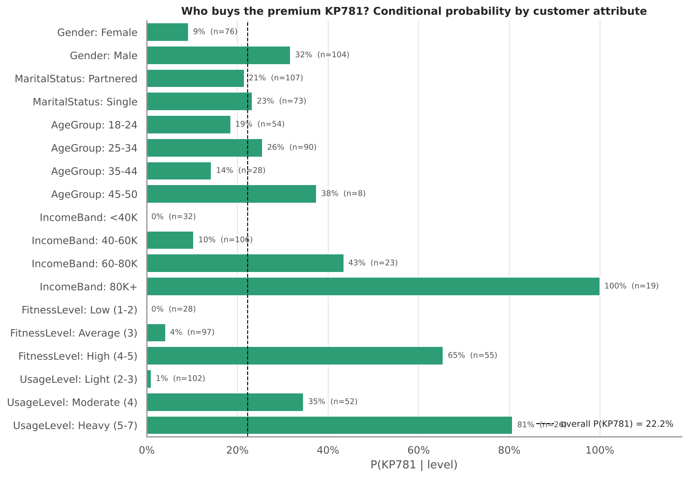
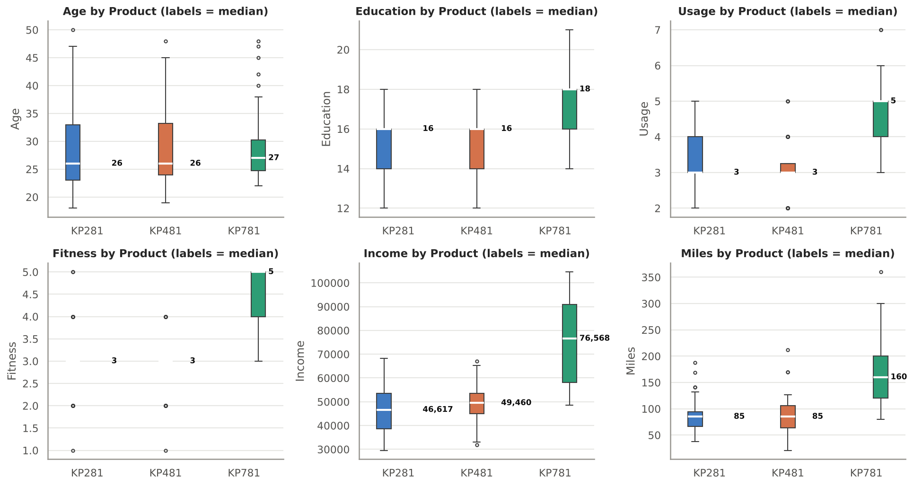
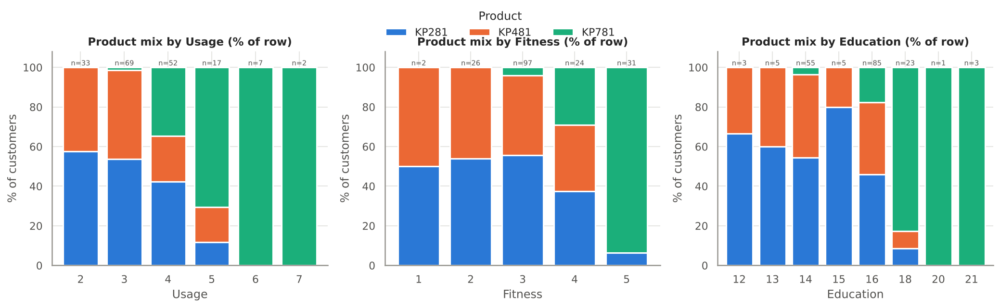
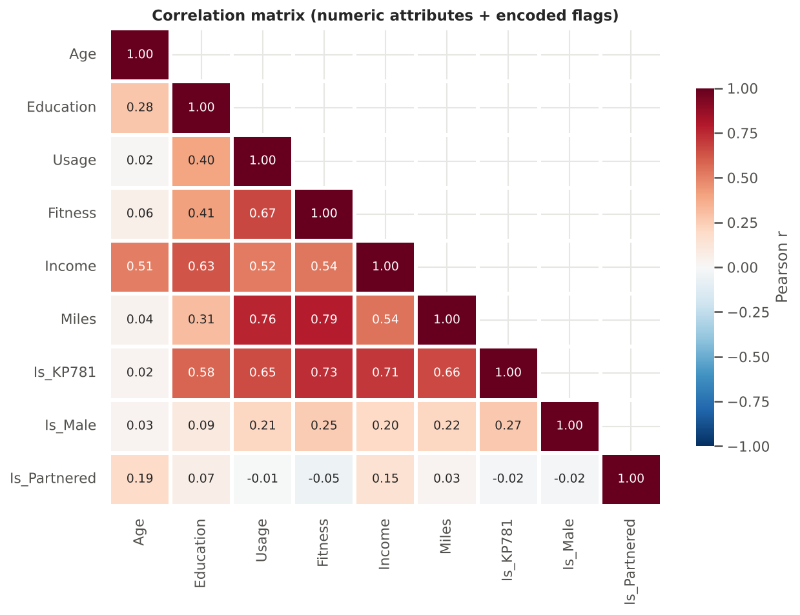
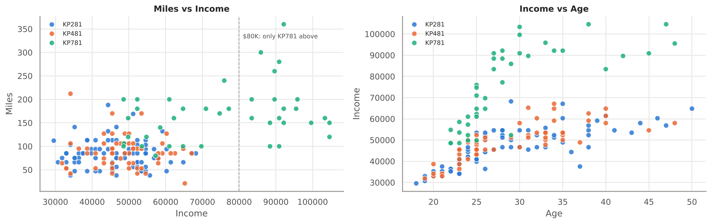
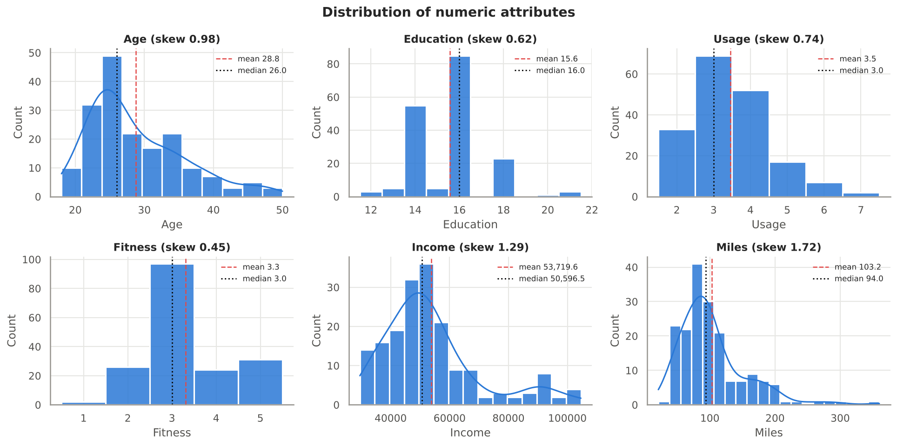
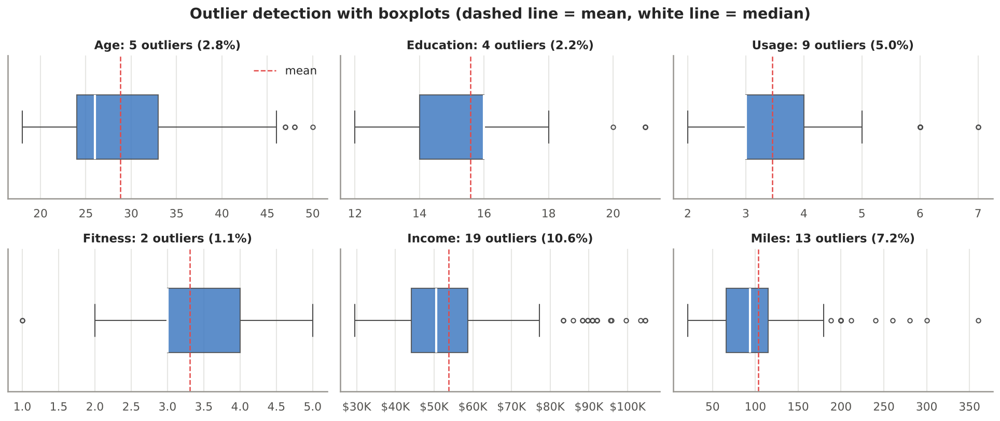

# Aerofit Treadmill Buyers: Customer Profiling with Descriptive Statistics & Probability


> **Who buys which treadmill, and how should Aerofit recommend the right one?**
> An end-to-end exploratory data analysis and probability study of 180 Aerofit customers, built as part of the Scaler Data Science & ML program.

**Author:** Guntuku Hariprasad · [Full notebook](notebooks/Aerofit_Case_Study.ipynb) · [PDF report](reports/Aerofit_Case_Study.pdf) · [Insights & recommendations](reports/insights_and_recommendations.md)

---

## Business problem
Aerofit sells three treadmills:

| Model | Positioning | Price |
|---|---|---|
| **KP281** | Entry level | $1,500 |
| **KP481** | Mid-level runners | $1,750 |
| **KP781** | Advanced features | $2,500 |

The market research team wants to **identify the target audience for each product** so it can give new customers better recommendations. The questions are whether the products differ in customer characteristics, and what the marginal and conditional probabilities of buying each model are for different customer groups.

## Dataset
[`data/aerofit_treadmill.csv`](data/aerofit_treadmill.csv): 180 customers who bought an Aerofit treadmill in the prior three months. See the [data dictionary](data/README.md).

`Product · Age · Gender · Education · MaritalStatus · Usage · Income · Fitness · Miles`

## Approach
1. **Basic metrics:** shape, dtypes, conversion to `category`, statistical summary
2. **Non-graphical analysis:** value counts, unique values, product-level means and medians, revenue mix
3. **Missing values & outliers:** null and duplicate checks, IQR fences, mean vs median, boxplots, clipping sensitivity
4. **Univariate visuals:** histograms + KDE, countplots
5. **Bivariate visuals:** countplots by product, stacked product-mix bars, boxplots by product and gender, scatterplots
6. **Correlation:** heatmap (with encoded product, gender and marital flags) and pairplot
7. **Probability:** two-way contingency tables (`pd.crosstab`) with **marginal, joint and conditional** probabilities for gender, marital status, age, income, fitness, usage and miles, a Bayes check, and **chi-square tests of independence**
8. **Customer profiling, insights and recommendations**

## Key findings

| | KP281 | KP481 | KP781 |
|---|---|---|---|
| Share of buyers | 44.4% | 33.3% | 22.2% |
| Share of revenue | 36.9% | 32.3% | 30.8% |
| Median income | $46.6K | $49.5K | **$76.6K** |
| Usage (days/week) | 3 | 3 | **5** |
| Fitness (1-5) | 3 | 3 | **5** |
| Miles per week | 85 | 85 | **160** |
| Male share | 50% | 52% | **82.5%** |

* **Income is the strongest driver:** P(KP781 | income > $80K) = **100%**, P(KP781 | income < $40K) = **0%**.
* **Fit, frequent runners buy the KP781:** P(KP781 | 5-7 days/week) = **80.8%**, P(KP781 | fitness 4-5) = **65.5%**.
* **Gender gap at the premium end:** P(KP781 | Male) = **31.7%** vs P(KP781 | Female) = **9.2%**, although female KP781 buyers are just as fit and affluent.
* **Age and marital status don't change the model choice** (chi-square p > 0.05).
* **KP281 and KP481 buyers are nearly indistinguishable.** The $250 price gap is the deciding factor.



<details>
<summary><b>More charts</b></summary>

| | |
|---|---|
|  |  |
|  |  |
|  |  |

</details>

## Recommendations
1. **A three-question sales checklist** (days per week, fitness 1-5, budget) that maps customers to the right model.
2. **Market the KP781 to women** through female athletes, running clubs and gyms.
3. **Financing and trade-in offers** to bring fit, frequent runners earning $40K to $80K up to the KP781.
4. **Reposition the KP481** as "the treadmill you won't outgrow" and bundle extras to justify the $250 step-up.
5. **Keep the KP281 the easy starter**, aimed at students, first-job buyers and couples.
6. **Household offers** (59% of buyers are partnered) and **upgrade campaigns** for KP281 owners after 6 to 12 months.

Full reasoning is in [reports/insights_and_recommendations.md](reports/insights_and_recommendations.md).

## Repository structure
```
├── data/
│   ├── aerofit_treadmill.csv        # raw dataset (180 x 9)
│   └── README.md                    # data dictionary & source
├── notebooks/
│   └── Aerofit_Case_Study.ipynb     # full analysis, executed with outputs
├── reports/
│   ├── Aerofit_Case_Study.pdf       # notebook exported to PDF (24 pages)
│   └── insights_and_recommendations.md
├── images/                          # all charts as PNG
├── archive/                         # earlier version of this report, kept for reference
├── scripts/
│   ├── build_notebook.py            # regenerates the notebook from source
│   └── export_pdf.py                # notebook -> PDF via headless Chrome
└── requirements.txt
```

## Reproduce
```bash
git clone https://github.com/dot-hpg/aerofit-customer-analysis.git && cd aerofit-customer-analysis
pip install -r requirements.txt
jupyter notebook notebooks/Aerofit_Case_Study.ipynb          # explore interactively
# or rebuild everything from scratch
python scripts/build_notebook.py
jupyter nbconvert --to notebook --execute --inplace notebooks/Aerofit_Case_Study.ipynb
python scripts/export_pdf.py                                 # needs Chrome/Chromium installed
```

## Skills demonstrated
Exploratory data analysis · Descriptive statistics · Outlier detection (IQR) · Data visualisation · Contingency tables · Marginal, joint & conditional probability · Bayes' theorem · Chi-square test of independence · Customer segmentation & profiling · Translating analysis into business recommendations
